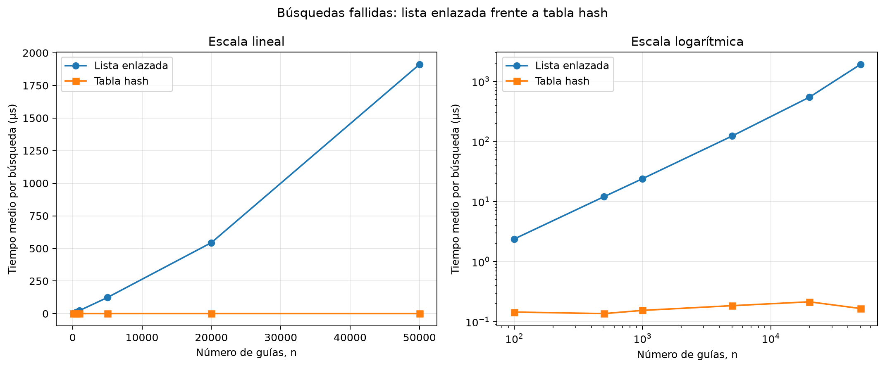
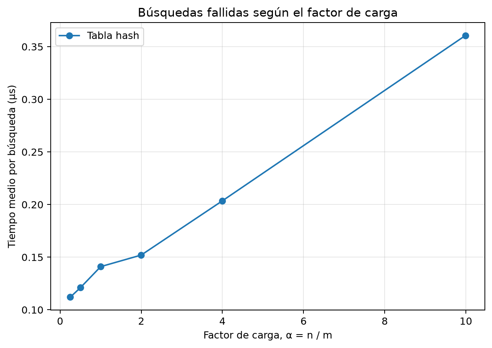

# Laboratorio evaluativo 03 - Estructuras de datos

**Nombre:** Tomás González Zapata

## Reproducción

Desde la raíz del repositorio, en PowerShell:

```powershell
Set-ExecutionPolicy -Scope Process Bypass
.\venv\Scripts\Activate.ps1
cd lab3-estructuras-datos
python pruebas.py
python medicion.py
```

El entorno virtual de la raíz contiene matplotlib. `pruebas.py` verifica las
estructuras y `medicion.py` repite los experimentos y genera las gráficas en
la carpeta `graficas/`.

## Parte 1 - Implementación y verificación

[Estructuras](estructuras.py) | [Pruebas](pruebas.py)

La lista enlazada inserta cada guía al inicio y realiza búsquedas iterativas.
La tabla hash reutiliza una lista por casilla y distribuye las guías con el
método de la división. Las pruebas cubren búsquedas exitosas y fallidas,
tamaños, estados y la colisión de 10, 24 y 17 en la casilla 3 cuando `m=7`.
También verifican el factor de carga `3/7` y comparan ambas estructuras en 30
colecciones aleatorias reproducibles, con claves existentes e inexistentes.
Todas las pruebas finalizaron sin errores. La implementación no usa las
estructuras hash incorporadas de Python y cada búsqueda de la tabla recorre
únicamente la cadena de la casilla calculada.

## Parte 2 - Medición y gráficas

[Código de la medición](medicion.py)

Las guías únicas de diez dígitos se generaron con semillas fijas. En cada dato
se cronometraron únicamente 200 búsquedas fallidas. El lote se repitió cinco
veces y se tomó la mediana de los cinco tiempos medios por búsqueda para
reducir el ruido del sistema operativo. La construcción, la generación y las
comprobaciones quedaron fuera del cronómetro. En el primer experimento se usó
el primer primo mayor o igual que `n/2`, por lo cual `α` permaneció cerca de 2.

| n | m | α real | Lista (µs) | Tabla (µs) |
|---:|---:|---:|---:|---:|
| 100 | 53 | 1,8868 | 2,3850 | 0,1450 |
| 500 | 251 | 1,9920 | 12,0225 | 0,1365 |
| 1.000 | 503 | 1,9881 | 23,9945 | 0,1545 |
| 5.000 | 2.503 | 1,9976 | 123,1975 | 0,1850 |
| 20.000 | 10.007 | 1,9986 | 544,1725 | 0,2145 |
| 50.000 | 25.013 | 1,9990 | 1.911,1700 | 0,1660 |



Para aislar el efecto de `α`, el segundo experimento mantuvo `n=20.000` y las
mismas consultas mientras cambiaba el número de casillas.

| m | α real | Tabla (µs) |
|---:|---:|---:|
| 80.021 | 0,2499 | 0,1120 |
| 40.009 | 0,4999 | 0,1210 |
| 20.011 | 0,9995 | 0,1410 |
| 10.007 | 1,9986 | 0,1520 |
| 5.003 | 3,9976 | 0,2035 |
| 2.003 | 9,9850 | 0,3605 |



## Parte 3 - Análisis

### 1. Costo teórico

Si una guía no está en la lista, `buscar` debe comparar los `n` nodos antes de
saberlo; el costo es `Θ(n)`. En la tabla se calcula una casilla en tiempo
constante y se recorre solo su cadena. Con distribución uniforme, cada casilla
recibe en promedio `α=n/m` elementos, así que la búsqueda promedio cuesta
`Θ(1+α)`: uno por calcular el índice y `α` por la cadena. El supuesto es que la
función hash reparte las guías de manera aproximadamente uniforme. Si todas
cayeran en una casilla, esa cadena tendría `n` nodos y la tabla volvería a
costar `Θ(n)`.

### 2. Lo medido contra lo esperado

Los factores de todos los intervalos consecutivos fueron:

| Cambio de n | Factor de n | Lista | Tabla |
|---:|---:|---:|---:|
| 100 a 500 | 5,00 | 5,04 | 0,94 |
| 500 a 1.000 | 2,00 | 2,00 | 1,13 |
| 1.000 a 5.000 | 5,00 | 5,13 | 1,20 |
| 5.000 a 20.000 | 4,00 | 4,42 | 1,16 |
| 20.000 a 50.000 | 2,50 | 3,51 | 0,77 |

La lista sigue de cerca el aumento de `n`, como predice `Θ(n)`. El último
factor se aleja más; recorridos largos pueden variar por caché, actividad del
sistema y frecuencia del procesador. La tabla no crece con `n` porque `α`
permanece cerca de 2. Sus pequeñas subidas y bajadas son normales al medir
fracciones de microsegundo. En la segunda gráfica, al pasar de `α=0,2499` a
`9,9850`, el tiempo aumentó de 0,1120 a 0,3605 µs. Los factores consecutivos
fueron 1,08; 1,17; 1,08; 1,34 y 1,77. La tendencia ascendente es coherente con
`Θ(1+α)`, aunque el término constante domina para valores pequeños.

### 3. Colisiones

Una colisión ocurre cuando claves distintas producen el mismo índice. Puede
ocurrir aun con más casillas que guías porque el residuo no depende solo de la
cantidad de espacios: 10, 24 y 17 producen residuo 3 al dividir entre 7. El
encadenamiento guarda las tres en una lista de la casilla 3. Permite `α>1` y
facilita insertar, pero consume memoria en enlaces y se hace lento si las
cadenas crecen. El direccionamiento abierto busca otra posición dentro del
arreglo. Aprovecha mejor la caché y evita nodos, pero necesita `α<1`, sufre
agrupamientos y complica la eliminación.

### 4. Tabla hash o árbol de búsqueda

La tabla no conserva orden; para encontrar el intervalo entre X y Y habría que
revisar todas las casillas. Un árbol de búsqueda sí ordena las claves y permite
recorrer solo el rango en orden. Si las 400.000 guías ordenadas se insertaran
en un árbol común, cada nodo quedaría como hijo del anterior: altura 399.999 y
cerca de 400.000 comparaciones en el peor caso, también `Θ(n)`. Un árbol
equilibrado tendría alrededor de 19 niveles, búsqueda `Θ(log n)` y consulta de
rango `O(log n+k)`, donde `k` es la cantidad de resultados.

### 5. Concepto para la jefa de operaciones

Recomiendo mantener dos índices sobre los mismos envíos: una tabla hash para
el call center y un árbol equilibrado para los rangos. La primera ofrece
búsqueda puntual promedio constante; el segundo conserva el orden sin el
riesgo de degeneración del árbol común.

Para 5.000.000 de envíos hice estimaciones, no mediciones directas. Tomé
`n=50.000` como única referencia porque es el mayor tamaño medido y reduce la
distancia de extrapolación. La gráfica respalda el crecimiento lineal de la
lista; multiplicar `n` por 100 lleva sus 1.911,1700 µs a unos 191.117 µs, es
decir, 191,1 ms por búsqueda fallida. En una tabla dimensionada para conservar
`α≈2`, `Θ(1+α)` no introduce ese factor 100, por lo que la referencia es unos
0,1660 µs. En producción pueden cambiar por memoria, caché, equipo y carga
simultánea, pero la diferencia de forma entre las curvas permanece.
